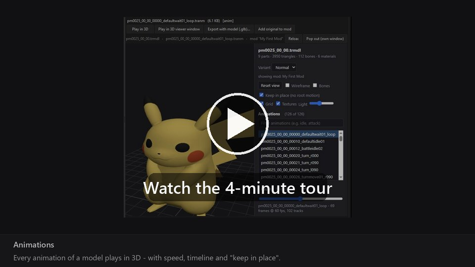

# Lumiose Toolkit

A Windows toolkit for exploring and modding **Pokémon Legends: Z-A** game files.
Browse and preview everything in your own game dump, export it to standard formats
(PNG, glTF, JSON, WAV, text), edit textures, models, text, Pokémon, moves, items, shops,
trainers and map placements, then package your changes as a mod for ZA Recomp (and builds based
on it), a modded Switch (Atmosphere) or an emulator.

> **No game files are included.** You need your own legally dumped copy of the game.
> This project is not affiliated with Nintendo, The Pokémon Company, Game Freak or Creatures.

[](https://nibinemui.github.io/Lumiose-Toolkit/)

**▶ [Watch the video tour](https://nibinemui.github.io/Lumiose-Toolkit/)** - the full program in 4 minutes, plus what's new in 1.2 and 1.3.

---

## Contents

- [Features](#features)
- [Requirements](#requirements)
- [Installation](#installation)
- [Updating](#updating)
- [Importing your game files](#importing-your-game-files)
- [First steps](#first-steps)
- [Using the program](#using-the-program)
- [Making and sharing mods](#making-and-sharing-mods)
- [Troubleshooting](#troubleshooting)
- [Known limits](#known-limits)
- [Running from source (developers)](#running-from-source-developers)
- [Project layout](#project-layout)
- [Credits and licences](#credits-and-licences)
- [AI disclosure](#ai-disclosure)

---

## Features

Features marked **(experimental)** show a warning in their window: some things may not work properly or look
incorrect. They are Port a Pokémon (and its icons), Create Spawn Point, Hyperspace Pokémon, new battle music, Play as a
character, glTF model import and sound replacement. Test what they make with a copy of your save before sharing a mod.

### Browse & extract
- **Search by in-game name**: Pokémon (`pikachu`, `25`), clothing (`v-neck t-shirt`), or any file/folder name. Small typos are fine.
- **Search the game's text**: every line of dialogue, item and move names in any language; click a result to jump to that line. **Search all text…** searches every language at once and shows the whole line.
- **Find textures by what they show**: every texture has a plain-English description in the **About** column - the
  Pokémon, clothing item, character, building, map object or icon it belongs to, the part, and what it does (colour,
  bumps, colour regions…). Search matches it too: `pikachu body`, `billboard`, `poster`, `marble`, `poke ball icon`.
  Japanese words in map names get their English meaning (`kanban (signboard)`), and accents don't matter.
- **Show** filter: list only textures, text, UI archives, models, models + textures, or animations.
- **Preview every file type**:
  - **Textures** (`.bntx`): every BC1–BC7/BC6H format, with channels, mip levels, array layers, zoom and pixel values.
    When your current mod has its own version of a texture, the preview shows that one (**Show game original** to compare).
  - **Models** (`.trmdl`): shown in 3D right in the preview pane (interactive **3D viewer**), like textures are.
  - **Animations** (`.tranm`): play them on their model in the 3D viewer.
  - **Data**: FlatBuffer `.bin` files shown as readable JSON. This covers every Trinity format (`.trmtr`, `.trskl`, `.trmsh`, `.trscn`, …), the player customisation files (`.ccdata`, `.ccdatam`, the clothing group table) and any `.bin` with a schema.
  - **Text** (`.dat`/`.tbl`): decoded message files.
  - **Audio** (Wwise `.bnk`/`.pck`): list and play sounds. The **Audio** tab lists them all by name.
  - **UI archives** (`.arc`): open like folders; the textures inside preview too.
- **Batch extraction** (Ctrl+E): textures → PNG (+DDS), models → glTF/GLB (optionally with all animations), data → JSON, audio → WAV, and other files copied as-is.

### 3D viewer
- **Right in the main window**: click a model (`.trmdl`) in the file list and it shows in 3D in the preview pane, where textures are shown. *Try on player body*, *Play in 3D* (animations) and the colour-variant buttons open there too; **Pop out (own window)** opens the same view in a separate window.
- Orbit camera, wireframe, bones, textures on/off, lighting.
- All animations of a model, with filter, speed, timeline and **Keep in place** (removes root motion).
- Faithful colours: the game's layer-colour system, colour-table palettes, UV scale/offset and mirror/wrap modes.
- **Variants**: normal and shiny Pokémon, plus other material sets.
- **Try on player body**: shows a clothing item on the player with face, hair and other clothes and all 301 player animations.
- **Clothing patterns and colours**, just like the in-game boutique: pick the pattern, main colour, second colour and skin tone. Colours use their in-game names (e.g. "Scizor Orange").
- **Every shop variant**: a clothing search result lists all its colour variants (with id and price), and *Game data → Clothing items* has *Try on* / *View in 3D* per row; both open the viewer on exactly that variant.
- **Live reload**: the viewer refreshes by itself whenever your mod changes.
- **A texture's model**: *Show its model in 3D* on a texture opens the model it belongs to (in the pane or a window,
  set in Preferences), so texture edits show on the model as you save them.

### Editing (everything is saved into the *current mod*, never into the game files)
- **Textures**:
  - Import a **PNG or DDS**. A PNG is re-compressed to the original format with all mips, optionally at a new size. A DDS
    in the texture's own format goes in exactly as it is (no recompression); any other DDS is compressed like a PNG.
    Textures inside `.arc` archives and every layer of array textures work too. The preview updates to show the result.
  - **Live editing**: opens the texture in an image editor; every save is imported automatically and shows in the 3D viewer. Choose the editor in **Preferences**: the built-in **miniPaint** (offline), **Photopea** in a window (online), Paint, or any program you have.
- **Material colours**: colour pickers and numbers for every material parameter, with a live 3D preview.
- **Clothing colours**: *Edit clothing colours…* changes which palette colour each in-game colour option uses (per pattern and layer, picked from the item's palette swatches), saved into your mod, with a live 3D preview. *Confirmed working in-game (Lumiose Online).*
  - **Custom colours**: *Custom colour…* opens a colour wheel with a hex code box, so you can use any colour, not just the palette's. Other clothing that shares the palette keeps its exact colours (see [Custom clothing colours](#custom-clothing-colours)). *New - not yet confirmed in-game.*
- **Pattern textures**: *Edit pattern textures…* lists every texture of a clothing pattern (base, layer mask, palette, normal map…) with a preview, explains what each one does, marks textures shared with other patterns or other items, and opens them for live editing.
- **Game text**: in-app editor with search, highlighted `[VAR …]` codes and multi-line text. Export/import as a text file also works.
- **Pokémon data** (`personal_array`): types, abilities, base stats, EV yield, catch rate, growth rate, gender, egg groups, size, level-up moves, evolutions, TM moves and egg moves.
- **Port a Pokémon** (experimental): bring a Pokémon from a Scarlet/Violet dump into Z-A as a new Pokémon in a free species slot (model, animations, Z-A materials, species data, moves, alpha move, cry, wild behaviour, Pokédex entry, spawns), with icons rendered in Z-A's style.
- **Game data tab**: a table editor for:
  - **Moves**: power, accuracy, PP, type, category, priority, status effects, stat changes and every flag.
  - **Items**: price, max stack and TM move.
  - **Item shops**: what each shop sells and when it appears.
  - **Clothing items**: prices, colours and icons.
  - **Clothing shops** and **hair & make-up** salons.
  - **Trainers**: team species, level, moves, item, nature, ability, IVs, EVs, shiny and ball.
  - **Item balls**: contents and drop weights.
  - **Any other data file** with a schema ("Open other data file…" or "Open in table editor").
  - **Search all tables…**: one search across every table (over 2,200), by name or number, that opens the matching row.
- **Map editor**:
  - Shows the Lumiose City map with every placement layer: Pokémon spawns, item balls, random items, NPCs, walking NPCs, royale cards and move gimmicks.
  - Move, rotate, duplicate and delete points.
  - Edit the **encounters** at a spawn: species, levels and weight.
  - **Add spawn point…**: a new Pokémon spawn point with the Pokémon and levels you pick, placed by dragging.
  - **Create Spawn Point…** (experimental): click any empty spot to add a Pokémon spawner (species, form, levels,
    size, always an alpha; always, by day or at night), an item ball or a move gimmick (Mega Shard crystals,
    Hyperspace boxes, breakable rocks, vines, sludge). Megas and other forms never seen in the wild get their normal
    form's wild behaviour.
  - **Hyperspace Pokémon…** (experimental): which Pokémon Hyperspace Lumiose brings for each zone type and rank -
    change them, their levels and alpha chance, or add and remove Pokémon.
  - **Show Pokémon icons**: each Pokémon spawn point shows the icon of the Pokémon most likely to appear there.
  - Points your current mod added are drawn black, so they stand out from the game's own.
  - Edit the **contents of item balls** and random items, with "Make unique" so other spots aren't affected.
  - Pick any **interior, dungeon or zone** from the Area list. Optionally lay a dungeon floor map underneath and align it; the alignment is saved per area.
- **Audio tab**: every song, jingle, sound effect, Pokémon cry, voice and ambience sound (over 14,000), searchable by
  name, with its type. Play, export and **replace** them with any audio file (WAV, MP3, OGG, FLAC, M4A…), with
  volume, loudness matching and loop points. **Add as new battle music…** (experimental) adds a song to the
  "Battle BGM" list of online Private Battles as a new entry, and can make it the music of every trainer battle
  (it still fades out and plays the victory jingle at the end).
- **Play as a character** (Mods tab, experimental): the player becomes one of the game's characters (18 named
  characters and 93 trainer and townsfolk outfits), fitted to the player's skeleton; the player's own face, hair and
  clothes are hidden. **Show in 3D** shows each one first.
- **Also experimental**:
  - Import an edited glTF back into a model. Tangents are recomputed from the UVs, each vertex keeps its strongest bone
    influences, and it warns when a part ends up on the other side of the body from the bones it follows (e.g. a
    mirrored wing), about unknown bones and about materials left without triangles. A file from a different model is
    refused.
  - Replacing sounds (Audio tab) - song replacement is confirmed working in-game; sound effects, cries and loop
    points are not confirmed yet.

### Mods
- Mod projects with name, author, version and description; "Add original to mod" copies any file into a mod for hand editing. Renaming a mod renames its folder too.
- **Merging**: when several mods change the same game data table or text file, building or installing them together merges them row by row instead of one mod overwriting the other.
- **Merge mods…**: combine several of your mods into one new mod, merged the same way (the mods themselves stay as they are).
- **Select several mods** with Shift / Ctrl + click and delete them all at once (**Delete…** or the Delete key).
- **New clothing items**: make a new, buyable item from any existing one (its own model copy, ids, name and shop), without replacing anything in the game. They work everywhere in the program: Search, Try on, Show in 3D and Edit colours.
- **New hairstyles**: make a new hairstyle from any existing one (its own model and hair animations, id, name and salons).
- **Check new items**: checks a mod's new clothing items and hairstyles before you share it (ids, files, names in every language, shops and salons).
- **Your own id series** (Preferences → Mods): each person who makes new items picks a different number, so items made on different computers never get the same ids.
- **Test checklist**: a list of what to check in the game, made from what the mod changes, to tick off, copy and share.
- **History**: every version of every changed file is kept. Compare any version with the game original or the previous version (text line by line, data field by field, textures side by side), and restore any version.
- **Load order** across your own mods and downloaded mods (`.zip` or folders).
- **Repair**: mod files saved by 1.3.1 or older (which could crash the game, e.g. imported models) are found when the
  program starts, and it offers to repair them once; the old versions stay in History.
- **Conflict check**: finds game files that more than one mod changes - your own mods, downloaded mods and the mods already installed in ZA Recomp / Lumiose Online (including other people's). It tells real conflicts from identical copies and shows which mod wins in-game (from Recomp's Mods page order). *Install to Recomp* warns before installing over another mod's files.
- **Packaging** for:
  - **ZA Recomp / Lumiose Online**: one-click "Install to Recomp", or a package to install from the Mods page.
  - **Switch (Atmosphere)**: `atmosphere/contents/0100F43008C44000/romfs/…` with a patched `data.trpfd`.
  - **Emulators** (Ryujinx-style mod folders) with a patched `data.trpfd`.
- Launch ZA Recomp / Lumiose Online straight from the program to test a mod.

### Extras
- **Preferences…** (bottom right):
  - **General**: dark or light theme, interface size (90-150%, for high-resolution screens), update check at startup.
  - **Image editor**: built-in miniPaint, Photopea, Paint or any other program for live texture edits.
  - **3D view**: show models in 3D when clicked, open Try on / Play in 3D in the preview pane or their own window, texture quality (1024 / 2048 / 4096 px).
  - **Mods**: how many versions of each mod file the history keeps (10 / 30 / 100).
- Dark mode (also on the top bar).
- **Import game files** unpacks your dump right inside the program (see [below](#importing-your-game-files)).
- **Built-in updater**: checks GitHub for a new version when the program starts and installs it with one click,
  keeping your mods and settings (see [Updating](#updating)).
- **Patch notes** (bottom right): what changed in every version, in a *What's new* window that also opens by itself
  once after each update.
- **Report a bug…** (bottom right, and offered when an error pops up): collects your version, Windows version and
  recent errors with your user name and folders hidden, and opens the bug report form on GitHub; nothing is sent
  automatically.
- Unnamed hash files are identified by their contents.

---

## Requirements

| What | Notes |
|---|---|
| Windows 10 or 11 (64-bit) | Nothing else to install: Python and every helper tool are inside the download. |
| Your own dump of Pokémon Legends: Z-A | The RomFS of the game (title ID `0100F43008C44000`), dumped from your own Switch. |
| Oodle DLL (`oo2core_8_win64.dll`) | Needed once, to unpack the game archive. It can't be shipped with Lumiose Toolkit (see [below](#importing-your-game-files)); the program looks for it on your PC by itself. |
| About 25 GB of free space | For the unpacked game files. |
| [Microsoft Edge WebView2 Runtime](https://developer.microsoft.com/microsoft-edge/webview2/) | For the 3D viewer window. Already part of Windows 11 and up-to-date Windows 10. |

---

## Installation

1. Go to the **[Releases page](https://github.com/nibinemui/Lumiose-Toolkit/releases)** and download
   `Lumiose-Toolkit-<version>-windows.zip`.
2. Unzip it anywhere you like, for example `D:\Lumiose Toolkit`.
   Keep the folder together: the `.exe` needs the `_internal` and `tools` folders next to it.
3. Double-click **`Lumiose Toolkit.exe`**.
   - Windows may show *"Windows protected your PC"* the first time, because the program isn't code-signed.
     Click **More info → Run anyway**.
   - To get a desktop shortcut: right-click `Lumiose Toolkit.exe` → *Send to* → *Desktop (create shortcut)*.

On the first start the program downloads two small data files from
[PokeDocs](https://github.com/pkZukan/PokeDocs) (the file-name list and some data layouts). This needs an
internet connection once.

---

## Updating

Lumiose Toolkit checks this repository's [Releases page](https://github.com/nibinemui/Lumiose-Toolkit/releases)
when it starts. When a newer version is out, a **★ Update to x.y.z** button appears at the bottom right.

1. Click **★ Update to x.y.z** (or **Updates…** to check by hand). The window shows what's new.
2. Click **Download and install**. The program downloads the release zip from GitHub and checks it
   (size and SHA-256 checksum).
3. Confirm. Lumiose Toolkit closes, copies the new files into its folder and starts again.

After an update, the **What's new** window shows what changed (any time later: **Patch notes**, bottom right).

Your `mods`, `packages`, `extracted` folders, `settings.json`, imported game files and downloaded PokeDocs
files are kept: the update only replaces the program's own files. **Skip this version** hides the button
until the next release, and the check at startup can be turned off in the same window. The check sends no
data about you; it only asks GitHub for the latest release. A log of each update is written to
`update_log.txt` in the program folder.

To update by hand instead, download the new zip, unzip it, and move your `mods` folder and `settings.json`
into the new folder. When [running from source](#running-from-source-developers), use `git pull`; the update
window then only links to the release page.

---

## Importing your game files

The first time you start Lumiose Toolkit, the **Import game files** window opens. You can also open it
any time with **Import game files…** in the top bar.

1. **Game dump (RomFS):** pick your dump's `romfs` folder, the one that has an `arc` folder inside with
   `data.trpfd` and `data.trpfs`. Picking the folder above it works too.
2. **Put the game files in:** a folder with about 25 GB free. A suggestion is filled in for you.
3. **Oodle DLL:** found automatically if it's on your PC. If not, click **Browse…** and pick
   `oo2core_8_win64.dll` (or `oo2core_9_win64.dll`).
   - Oodle is a proprietary compression library owned by Epic Games (RAD Game Tools), so it can't be included
     here. It comes with several Pokémon modding tools (for example pkNX) and with many PC games.
4. Click **Import**. It unpacks all 238,546 files, then copies the dump's other folders (audio, …).
   - It never overwrites anything.
   - You can press **Stop** and continue later; Import picks up where it stopped.

When it's done, Lumiose Toolkit switches to the new folder by itself.

Already unpacked the game with another tool? Click **I already have the files – choose the folder…** instead.

> Command-line alternative: `restore_missing.exe` in the program folder does the same unpacking.
> Run it without arguments to see how to use it.

---

## First steps

- The first start indexes the files and names (a few seconds). The first *Game text* search builds a text index.
- In the top bar, **Game folder** is where your game files are, and **Output** is where exported files go
  (default: the `extracted` folder next to the program).
- Click **New mod…** before editing anything. Every edit goes into the *current mod*, never into the game files.
- On the **Mods** tab:
  - **Game romfs** is filled in by the import (your unmodified dump's `romfs` folder). Switch and emulator packages need it.
  - **ZA Recomp / Lumiose Online folder** is found automatically if you have ZA Recomp installed. If you have
    several installs, pick the one you want mods in.

---

## Using the program

### Browse & extract
Type in the search box at the top left to search. Use **in: Files & names** for names, or **in: Game text** plus a language to search the text.
**Search all text…** (next to the language list) opens a window that searches every line of game text in one language
or all of them at once, without caring about case or accents ("quotes" find a phrase). It shows the whole line and
the label, includes the current mod's changed text, and opens the line in the text editor on double-click.
Textures are also found by **what they show**: the **About** column describes each one (the Pokémon, clothing item, character, building, map object or icon it belongs to, the part, and what the texture does), and search matches that too - try `pikachu body`, `billboard`, `poster`, `neon`, `marble` or `poke ball icon`. Japanese words in map names get their English meaning (`kanban (signboard)`), and accents don't matter.
Click a file to preview it. The buttons above the preview change with the file type. Right-click files for Extract, *Add original file(s) to current mod*, *Show in Explorer* and *Copy path*.
Select files or folders, tick the conversions at the bottom, then press **Extract selected** (Ctrl+E).

### Textures
- **Import PNG/DDS into mod…**: replaces the texture. If the image has a different size, you choose whether to rebuild the texture at that size.
  - **DDS**: a DDS in the texture's own format and size (with enough mip levels) goes in **exactly as it is**, with no recompression - e.g. a texture exported with *+ DDS*, edited in a DDS-aware editor and saved in the same format. Any other DDS (another format such as BC1 for a BC7 texture, fewer mip levels, another size) is decoded and compressed like a PNG. Like the toolkit's own DDS export, a DDS holds the channels the texture stores (no channel swapping).
- **Your mod's version**: when the current mod has its own copy of a texture, the preview shows that one (the line above the picture says so); tick **Show game original** to compare.
- **Live edit in image editor**: exports the PNG and opens it for editing. Every time you save, it is re-imported into the mod and the preview updates. Use **Show its model in 3D** to watch the changes - in the preview pane, or in its own window with **Its model in viewer window** (Preferences… > 3D view sets which one *Show* uses). Stop with **Stop live edits**.
  Which editor opens is set in **Preferences…** (bottom right, or **Image editor…** above the texture):
  - **Built-in editor: miniPaint** (default) - opens in a toolkit window and works offline: layers, brushes, selections, filters. Press **Ctrl+S** or **Save to mod** to save into your mod.
  - **Photopea (online)** - opens [photopea.com](https://www.photopea.com), a Photoshop-like editor, in a toolkit window. Use **File → Save** or **Save to mod**. Needs an internet connection; Photopea is a third-party service and its free version shows ads.
  - **Windows' "Edit" program** - usually Paint.
  - **Another program** - GIMP, Paint.NET, Krita, Photoshop…: pick its `.exe`. Save over the same PNG.

### Models, clothing and the 3D viewer
- Selecting a model shows it in 3D in the preview pane (**Show in 3D**); **Open 3D viewer window** or **Pop out** opens it in its own window. **Export glTF (.glb)…**
- To list only models, set **Show** (next to the search box) to *Models (.trmdl)*, *Models + textures* or *Animations (.tranm)*.
- **Edit colours…** for materials.
- **Try on player body** for `p1_`/`p2_` clothing.
- In the viewer, *Variant* switches normal/shiny or the clothing **pattern**. The colour menus below it pick the clothing colours and skin tone.
- **Edit pattern textures…** (on a clothing model, a colour variant or a Clothing items row): pick the pattern, select a texture, and use **Live edit in image editor**. The base texture (`_alb`) holds the pattern and shading and is usually grey so the colour options can tint it; the layer mask (`_lym`) decides which areas take colour 1-4 (red, green, blue, alpha). Textures under *Shared game textures* are used by other items too, so editing them changes those as well.

#### Custom clothing colours
In **Edit clothing colours…**, pick a colour option, then press **Custom colour…** under a layer's swatches. Choose a colour on the wheel (brightness on the slider) or type a hex code such as `#12c4a0`.

How it works: a colour option can only point at a cell of the item's palette texture, and most palettes are shared by many items with almost every cell in use. So the first custom colour widens the palette to three times its cells. Each game colour stays exactly where other items read it, and the two new cells beside it become *private* cells for custom colours. This item is switched to the wide layout (its material files and colour options are converted). The shadow colour is derived from the game's own shading. Your mod then contains the widened palette, the item's material files and its `.trmmt`. Other items in the same mod get different private cells; the list is kept in `custom_colours.json` in the mod folder. Custom colours are new, so check them in-game before sharing a mod. Two mods that both widen the same palette will conflict (the conflict check shows it).

### Text
**Edit text…** opens the in-app editor:
1. Filter lines with *Find*.
2. Edit the selected line. Line breaks are allowed; keep the blue `[VAR …]` codes.
3. Press Ctrl+Enter to apply.
4. Press **Save to current mod**.

*Only changed lines* shows your edits. *Revert line to original* undoes one.

### Pokémon data tab
Pick a Pokémon on the left, edit it, then press **Save changes to current mod**.
- Evolutions are one per line: `method level argument species form`.
- TM moves and egg moves can be move names or numbers.

#### Port a Pokémon from Scarlet/Violet (experimental)
**Port a Pokémon from Scarlet/Violet…** (below the list) adds a Pokémon from your own Scarlet/Violet dump to the
current mod as a new Pokémon. Z-A has species data for every Pokémon up to #1010 but only uses 364; a Pokémon whose
data it has but doesn't use is a **free slot** - nothing in the game is replaced.
1. Choose your dump (its `romfs`, or the folder that holds `pokemon/data`) and pick a Pokémon. Only free slots are
   listed unless you untick it; Pokémon past #1010 can't be added (the game stops when one is caught).
2. **Animation system from**: Z-A uses its own animation system for every Pokémon, so the ported Pokémon borrows one
   from a Z-A Pokémon - its own animations still play. The list is ranked by how alike the walk cycles, skeletons
   and sizes are, and the best match is preselected. A Pokémon that hops, floats or flies makes it move like that
   too, so pick one that moves the same way.
3. Options: wild behaviour from the same Pokémon, its female model, the cry (the same Pokémon's, or your own sound
   file), the Pokédex (not listed / take over another Pokémon's entry / add a new entry - experimental), and new
   spawn points in a wild zone with a level range.
4. **Port into current mod**. The report lists what was written and a check of everything the game needs. Then pick
   a pose for its **icons** and fine-tune it in the icon editor (drag to turn, scroll to zoom, right-drag to move, a
   timeline for the exact moment of the animation, normal/shiny preview at the game's size); the toolkit renders them
   in Z-A's icon style and adds them to the mod.

What it writes: the model folder (mesh, skeleton, textures and animations as they are, materials rebuilt with Z-A
shaders, the borrowed animation system renamed to it, and every animation slot Z-A needs - missing ones get its
closest animation); its species row with the "in this game" flag, Z-A-usable moves and evolutions to Pokémon in the
game; resource table entry, size, movement, alpha move, wild behaviour and cry. Test with a copy of your save: a
save that has the Pokémon needs the mod installed.

### Game data tab
1. Pick a table, find a row and edit its fields. Not sure which table? **Search all tables…** searches every data
   table at once: type names or numbers (`Pikachu`, `Tackle`, `a0403_w01`, `25 alpha`) and double-click a result to
   open that row. Pokémon, move and item numbers can be found by their names; a number matches whole numbers only. The
   first search builds an index (about a minute, saved as `data_index.json.gz`); tables in the current mod are searched
   in the mod's version.
   - **Clothing items → New item from this…** makes a new clothing item from the selected one: a copy of its model in a
     new folder (`ik_chara/model_pc/<…>7000_00_<label>`), new item ids (series 60 and up, unused by the game), its name
     in every language, and optionally a shop that sells it. Nothing in the game is replaced. Then change its look with
     **Edit a texture…** (live edit) or replace files in its model folder. **Save data**: buying it stores its id in
     your save - keep the mod installed while a save has the item and back up saves first. Online, other players need
     the same mod to see it. Several people making items? Each sets a different **Your number** in
     **Preferences… → Mods** (60-99): number 61 gets folders `…7100…` and ids `…61…`, number 62 `…7200…`, and so on.
   - **Hairstyles, hair colours & make-up → New hairstyle from this…** (on a hairstyle row - its name is a model folder
     like `p0_hrs0002_00_medium`): a copy of its model and hair animations in a new folder, a new id, its name in every
     language and the salons you tick. The same save note applies.
   - Names are shown for moves, items, species, natures and clothing. Comboboxes filter as you type.
   - Nested lists (a shop's items, a trainer's conditions) have **Add copy / Add new / Remove / Up / Down**.
   - **Duplicate row**, **Delete row** and **Edit row as JSON…** work on whole rows.
2. Press **Save changes to current mod**.

Notes:
- The move, item and shop layouts were reverse-engineered for this tool. Fields still named `Unknown…` are not identified yet.
- The move, item, shop and clothing tables rebuild byte-for-byte identical when nothing is changed.

### Audio tab
The first time you open it, the tab builds its list of every sound and song (about a minute) and keeps it for next time.
- **Names**: the game's sounds only have numbers, so the names are the game's own sound event names (`PLAY_BGM_VS_BOSS_01`,
  `PLAY_PV_0359`), found in its data files - about 85% of sounds have one. Cries and Pokémon sounds also show the
  Pokémon (`· Absol`), move sounds the move (`· Headbutt`). Search matches all of it, and the audio id.
- **Type**: Music, Jingle (short tunes like healing at a Pokémon Center), Sound effect, Ambience, Pokémon cry, Voice
  or Vibration (controller rumble). **Group** says more (Moves, Menus, Cutscenes, Battle…).
- **Parts**: a song is often several audio files - an intro and a loop, layers, or versions per area or time of day -
  shown as *part 1 of 3*. Play them to find the one you want; each part is replaced on its own.
- **▶ Play** (or double-click / Space) plays your mod's version if it has one; **▶ Play original** plays the game's.
- **Replace in current mod**: pick any audio file, set the volume or tick *Match the original's loudness* (it never
  boosts so far that it distorts), and optionally set **loop points**:
  - *Songs*: the game repeats the part between loop start and loop end. Without loop points the whole file loops.
    The part before loop start plays as the intro; Wwise may also play it as a short lead-in into each repeat.
  - *Sounds*: loop points are used when the game loops that sound (ambience and other `_LP` sounds).
  - **▶ Preview** plays the result; with loop points it plays the seam (the end of the loop running into its start).
  The new audio is stored as 16-bit PCM inside the sound bank (`audio/wwise/bin/Switch/*.bnk`), so a mod never needs
  a copy of the 0.9 GB `Stream.pck`. Songs get their new length, so they don't cut off. Every replacement is checked
  by playing the rebuilt bank back. PCM is bigger than the game's compressed audio (about 10 MB per minute of stereo).
- **Restore original** puts the game's sound back. **History** on the Mods tab keeps every version too.
- **Add as new battle music…** (experimental): pick an audio file, then give the song a name. It becomes a new entry
  in the **Battle BGM** list of online Private Battles (the only battles that list is used for), unlocked from the
  start; none of the game's songs is replaced. Say **Yes** when asked about trainer battles to also make it the music
  of every trainer battle (Battle Zones and trainers who challenge you): it goes into the trainer theme's own intro and
  loop, so battles still end the game's way (the music fades out and the victory jingle plays). Volume, loudness
  matching and loop points work as for replacing.

### Map tab
- **Navigate**: mouse wheel zooms, dragging pans, clicking selects a point. *Find* searches point names and switches to the right area automatically.
- **Edit a point**: change X/Y/Z/rotation and press **Apply**, or tick **Edit mode** and drag the selected point. **Duplicate** and **Delete** are below.
- **Pokémon spawns**: edit species, levels and weight under *Encounters at this spawn*. *Add (copy)* makes an encounter used only by this spawn.
- **New spawn points**: select a Pokémon spawn point and press **Add spawn point…**. Pick the Pokémon (Pokémon ported
  into your mod are listed too) and the levels. The new point appears 3 m away with its own encounter; tick **Edit
  mode** to drag it into place. Saving writes its position, spawner, encounter and its entry in the area's scene file
  (the scene file is what makes the game place it). Spawn points of interiors without a scene file can't be copied.
- **Create Spawn Point** (experimental): click an empty spot and press **Create Spawn Point…**. A short menu asks
  what goes there:
  - a **Pokémon spawner**: species, form, levels, size (locked to the biggest while **Always an alpha** is ticked) and
    when it appears - always, only by day or only at night;
  - an **item ball**: item and count, also always / by day / at night;
  - a **move gimmick**: Mega Shard crystals, Hyperspace boxes, breakable rocks, thorny vines or sludge.

  The new point copies the nearest point of that kind (a Wild Zone's spawner only inside that zone) - its area, scene
  file and height - and gets its own data. Check its height (Y), tick **Edit mode** to drag it, then save. A Mega or
  other form never seen in the wild gets its normal form's wild behaviour, so it moves and fights instead of standing
  still. New NPCs and Hyperspace portals are planned for a later update.
- **Hyperspace Pokémon…** (experimental): pick a zone type (the 18 types) and rank (1-5) to see its spawn patterns,
  their spawners and each Pokémon's levels, alpha chance and spot (floating or on the ground). Change a Pokémon (for
  that spawner only, or everywhere it is shared), its levels and alpha chance, or add and remove Pokémon. A Mega or
  other form never seen in the wild gets its normal form's wild behaviour.
- **Show Pokémon icons**: each Pokémon spawn point shows the icon of the Pokémon most likely to appear there (ported
  Pokémon too).
- Points the current mod added are drawn black, ringed in their layer's colour. The map reloads when you switch the
  current mod.
- **Item balls and random items**: edit item, count and weight under *Contents*. Use **Make unique** first if the item table is shared with other points.
- **Interiors, dungeons and zones**: pick one from **Area**. Its points are shown on a 10 m grid. To use a floor map as the background:
  1. Choose it under **Background** (the lab and sewer floors are included).
  2. Tick **Align**.
  3. Drag and use the mouse wheel to move and scale the points onto the image. *Flip X / Flip Z / Rotate 90°* help if needed.
  4. Press **Save alignment**. It is stored in `map_calibration.json`, so you can share it.
- **Save changes to current mod** writes all edited tables.

---

## Making and sharing mods

A mod is just a folder: `Lumiose Toolkit\mods\<name>\romfs\<game paths>` plus `mod.json`.

On the **Mods** tab:
1. Select your mod and fill in its details. You can see and remove its files there.
2. Use **History / compare / restore…** (or double-click a file) to see every saved version, compare it, or roll it back.
3. Add the mods you want to the **load order**. When two mods change the same **game data table** (shops, items, clothing, moves…) or **text file**, they are **merged**: rows each mod adds are all kept, and only a field both change differently goes to the higher mod (the build log lists it). For other files (models, textures, sounds) the top one wins. Identical copies are never a conflict. Merging happens when you build or install the mods **together** - mods installed separately in ZA Recomp still replace each other's files. To keep a combination as one mod, use **Merge mods…** (under My mods): it makes a new mod from the mods you tick, merged the same way. **Check conflicts** opens a list of every file that more than one mod changes. It covers your mods, the load order and the mods installed in ZA Recomp / Lumiose Online, and shows which version the game uses.
   **Play as a character…** (experimental) makes the player one of the game's characters: pick one (**Show in 3D**
   shows it), then **Put into current mod**; **Remove from mod** puts the player back. Things a character holds in its
   hands are left out unless you tick *Keep what the character holds*.
   **Check new items** checks the selected mod's new clothing items and hairstyles (ids, files, names, shops) and
   writes the result to the build log. **Test checklist…** lists what to check in the game for that mod - tick what
   works, then copy or save it for whoever tests with you.
4. Pick the targets and press **Build packages**:
   - **ZA Recomp / Lumiose Online**: `<name>/romfs/…`. Or press **Install to Recomp** to copy it straight into Recomp's `mods` folder, then turn it on in the Mods page and start the game with **▶ ZA Recomp** or **▶ Lumiose Online**. Recomp builds the file index itself, so no patched `data.trpfd` is needed, and mods can be switched on and off individually.
   - **Switch (Atmosphere)**: copy the `atmosphere` folder to the root of the SD card.
   - **Emulator**: copy `0100F43008C44000/<name>` into the emulator's mod folder (Ryujinx: right-click the game → *Open Mods Directory*).

Switch and emulator packages include a patched `data.trpfd` that redirects the modded files (the same method as TrinityModLoader).
That index is made for exactly the mods in the package, so **build one combined package** with every mod you use.
"Game romfs" must point at an **unmodified** dump.

---

## Troubleshooting

| Problem | Fix |
|---|---|
| "Windows protected your PC" when starting | The program isn't code-signed. Click **More info → Run anyway**. |
| Antivirus deletes or blocks `Lumiose Toolkit.exe` | Some antivirus programs flag Python programs packed into an .exe (a known false positive). Allow the file, or [run from source](#running-from-source-developers). |
| The program doesn't start | Make sure the whole unzipped folder is kept together (`_internal` and `tools` next to the .exe). Errors are written to `error_log.txt` in the program folder. |
| Import: "Pick the Oodle DLL" | The Oodle DLL wasn't found on your PC. Pick `oo2core_8_win64.dll` (or `oo2core_9_win64.dll`) with **Browse…**; it comes with tools like pkNX and many PC games. |
| Import: "No arc\data.trpfd …" | Pick the dump's `romfs` folder, the one that contains the `arc` folder. |
| Pokémon data tab won't load / "PokeDocs" message | The program couldn't download the PokeDocs files. Connect to the internet and restart it. |
| 3D viewer window is blank | Install the WebView2 Runtime. |
| "Couldn't check for updates" | You're offline, or GitHub is limiting requests for a while. Click **Check again** later, or download the new version from the Releases page. |
| An update didn't finish | See `update_log.txt` in the program folder. Close any 3D viewer windows and update again, or install the new zip by hand (see [Updating](#updating)). |
| Game crashes with a mod made with 1.3.1 or older (e.g. an imported model) | Those versions dropped values from rebuilt files. Start 1.3.2 or newer and click **Yes** when it offers to repair mod files, then install the mod again. Re-import models to also get the improved import. |
| "No schema known for …" | That data file has no known layout yet; it can still be extracted as raw bytes. |
| No sound / audio list empty | The game's `audio` folder is missing from the game folder. Run **Import game files…** again; it copies it. |
| Something else | Program errors are written to `error_log.txt` in the program folder; extraction errors go to `_extract_errors.txt` in the output folder. |

**Reporting a bug:** click **Report a bug…** at the bottom right of the program (it also offers this when an error pops up). It collects your version, Windows version and recent errors, with your user name and folders replaced by placeholders. Click **Copy details**, then **Open bug report on GitHub**, and paste them into the form. Nothing is sent automatically. Please don't attach game files.

---

## Known limits

- **In-game confirmation**: clothing colour edits and replacing songs are confirmed working in Lumiose Online. Ported
  Pokémon, new spawn points (Pokémon by day or night, Megas, item balls, Mega Shard crystals), trainer battle music
  and Hyperspace Pokémon edits were tested in game for 2.0. Custom clothing colours (widened palettes) are new and
  need an in-game check. The features marked (experimental) - Port a Pokémon, Create Spawn Point, Hyperspace Pokémon,
  new battle music, Play as a character, glTF model import and sound replacement - may not work properly or look
  incorrect in some cases. Test them with a copy of your save before sharing a mod.
- **Viewer approximations**: eye effects and special shaders (hologram, fur, emission) are simplified. Clothing is shown in its rest pose unless you use *Try on player body*.
- **Interior and dungeon areas**: these reuse coordinates near the world origin, so they are told apart by the area code in point names. Floor-map backgrounds must be aligned by hand once per area.
- **Duplicated map points**: a copy only spawns something if the spawner data tables have an entry with that name.
- **Field names**: some data fields keep generic names (`Unknown12`, `Flag_ZA60`…) until someone identifies them.

---

## Running from source (developers)

The release .exe is built from this repository. To run or change the Python source instead:

1. Install [Python](https://www.python.org/downloads/windows/) 3.10–3.12 (tested on 3.11) and tick **"Add python.exe to PATH"**.
2. Clone the repository and install the packages:
   ```bash
   git clone https://github.com/nibinemui/Lumiose-Toolkit.git
   ```
   ```bash
   python -m pip install -r requirements.txt
   ```
3. Start it with **`Lumiose Toolkit.bat`** (or `python za_extractor.py`).
   The helper programs in `tools/` are part of the repository. If any are missing, get them from the links in
   [`THIRD_PARTY_NOTICES.md`](THIRD_PARTY_NOTICES.md) and put them back at the same paths
   (`tools/flatc/flatc.exe`, `tools/texconv/texconv.exe`, `tools/vgmstream/…`, `tools/three/…`).
4. Build the .exe release yourself:
   ```bash
   python -m pip install pyinstaller
   ```
   ```bash
   python build_exe.py
   ```
   This creates `dist/Lumiose Toolkit/` and `dist/Lumiose-Toolkit-<version>-windows.zip`.
5. Check that the build starts (main window, normal size, no errors):
   ```bash
   python tools/smoke_test.py "dist/Lumiose Toolkit"
   ```
   GitHub runs the build and this test on every push (**Actions → Test build**); each run keeps its zip for 7 days.

---

## Project layout

```
Lumiose Toolkit/
  Lumiose Toolkit.exe     the program (release download; also starts itself as the 3D viewer)
  restore_missing.exe     command-line game unpacker (release download)
  Lumiose Toolkit.bat     start the program from source
  za_extractor.py         main window (Browse & extract, Mods tabs)
  za_setup.py             Import game files window
  za_formats.py           BNTX textures, message text, SARC archives, file detection
  za_trinity.py           Trinity models, materials, skeletons, animations, glTF export, clothing colours
  za_viewer.py            3D viewer (local web server + pywebview window)
  za_modding.py           JSON ⇄ data, text/texture import, mods, history, packaging, Recomp install
  za_dataedit.py          Game data tab (schema-driven table editor)
  za_pokedit.py           Pokémon data tab
  za_map.py               Map tab
  za_mapcreate.py         Create Spawn Point (new spawns, item balls, move gimmicks; NPCs and portals for later)
  za_hyperspace.py        Hyperspace Pokémon window
  za_mated.py             material colour editor
  za_colours.py           clothing colour editor, custom colours (colour wheel), pattern textures window
  za_conflicts.py         mod conflict check (own mods, load order, mods installed in ZA Recomp)
  za_update.py            updater (checks GitHub releases, installs a new version)
  za_editor.py            image editor window for live edits (built-in miniPaint, or Photopea)
  za_prefs.py             Preferences window
  za_report.py            Report a bug window (collects anonymized details, opens the GitHub form)
  za_merge.py             merges mods that change the same data table or text (3-way, row by row)
  za_newitem.py           new clothing items and hairstyles (copies one: model, .ccdata, ids, names, shop/salon)
  za_checklist.py         in-game test checklist made from what a mod changes
  za_datasearch.py        Search all tables (index of every data table's rows, search window)
  za_textsearch.py        Search all text (index of every message file in every language, search window)
  za_bgm.py               New battle music (bank objects, music commands, battle music list, names)
  za_playas.py            Play as a character (player base model, hidden player parts, window)
  za_mergewin.py          Merge mods (several mods into one new mod, window)
  za_portmon.py           Port a Pokémon from Scarlet/Violet (model, materials, animation system, data, window)
  za_iconrender.py        renders Pokémon icons in Z-A's style in a hidden browser window (tools/icon_render)
  za_texnames.py          plain-English texture descriptions for Browse (About column, search)
  za_whatsnew.py          What's new window (shows CHANGELOG.md once after each update)
  za_version.py           version number and release repository
  za_textedit.py          in-app text editor
  za_history.py           mod history / compare / restore window
  za_import.py            experimental glTF → model import
  za_audio.py             WAV reading and PCM .wem writing (used by za_soundbank)
  za_soundbank.py         sound index (names, types) and replacing sounds in Wwise banks
  za_audiotab.py          Audio tab
  za_names.py             name index (Pokémon, clothing)
  za_deps.py              downloads the PokeDocs files (hash list, schemas) on first start
  restore_missing.py      unpacks data.trpfs (used by Import game files and restore_missing.exe)
  build_exe.py            builds the .exe release with PyInstaller
  gen_trinity_fbs.py      builds Trinity schemas from GFTool's sources
  bfbs_dump.py            prints a binary schema (.bfbs) as text
  names/                  fallback name lists (+ the PokeDocs hash list, downloaded)
  tools/                  helper programs, schemas, 3D viewer page, image editor pages, miniPaint, icon builder,
                          smoke_test.py (checks a built release starts)
  CHANGELOG.md            patch notes of every version (Patch notes button in the program)
  LICENSE                 GPL-2.0
  THIRD_PARTY_NOTICES.md, licenses/   licences of everything bundled
  source/                 (release download only) the complete source of that version
  mods/                   your mods (created on first use)
```

---

## Credits and licences

Lumiose Toolkit is licensed under the **GNU General Public License v2.0**; see [`LICENSE`](LICENSE).
Every bundled component, its licence and its source is listed in
[`THIRD_PARTY_NOTICES.md`](THIRD_PARTY_NOTICES.md); full licence texts are in [`licenses/`](licenses/).

- **Trinity format knowledge** (models, materials, skeletons, animations, mod-index patching) is ported from **[pkZukan/gftool](https://github.com/pkZukan/gftool)** (GPL-2.0), which is why Lumiose Toolkit is GPL-2.0.
- **Hash list and Scarlet/Violet schemas**: [pkZukan/PokeDocs](https://github.com/pkZukan/PokeDocs).
- **Gen 9 species numbering** (reference data): [kwsch/PKHeX](https://github.com/kwsch/PKHeX).
- **Move / item / shop / clothing-colour layouts**: reverse-engineered for this project.
- **Bundled tools**: FlatBuffers `flatc` (Google, Apache-2.0), `texconv` (Microsoft DirectXTex, MIT), vgmstream (ISC; its FFmpeg/mpg123 DLLs are LGPL-2.1, its Xiph codec DLLs are BSD), three.js (MIT). **Python packages** (bundled in the .exe, installed separately when running from source): NumPy (BSD), Pillow (MIT-CMU), pywebview (BSD).
- *Pokémon* and *Pokémon Legends: Z-A* are trademarks of Nintendo / Creatures Inc. / GAME FREAK inc. This is an unofficial fan tool for use with your own legally obtained copy of the game; no game files are included.

---

## AI disclosure

Lumiose Toolkit was made with the help of AI. It was developed by nibinemui together with **Claude**
(Anthropic's AI model, used through Claude Code). Claude wrote most of the program's code, the
reverse-engineered data layouts, the documentation (including this README) and the licence notices, under
nibinemui's direction and review.

What that means for you:

- **Test before you trust.** Every feature was tested on a real game dump while it was being built. In the
  game itself, clothing colour edits have been confirmed working in Lumiose Online (2026-11-14); the other
  features have not been confirmed in-game yet. Check your mods in-game before you share them, especially
  the parts marked *experimental*.
- **Reverse-engineered data can be wrong.** The move, item, shop and clothing-colour layouts were worked
  out by analysing the game's files. Fields still named `Unknown…` haven't been identified, and an
  identified field's meaning could still be off.
- **The licence notices were prepared with AI help, not by a lawyer.** They were researched from each
  project's actual licence files, but if you redistribute Lumiose Toolkit, check that they fit your
  situation.
- The program does not use AI while it runs. It does not send your files or data to any AI service. Its
  only network activity is downloading the PokeDocs data files on first start.
- The icon is a render of the game's own Luxury Ball 3D model, composed by Claude; no AI image generator
  was used.
